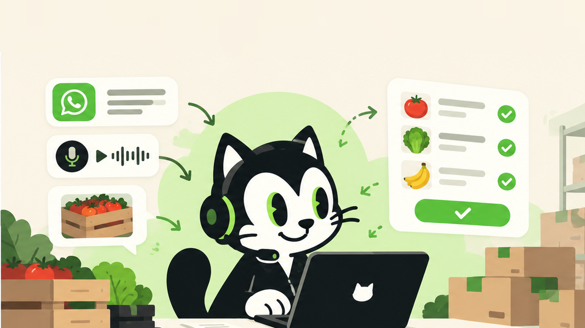
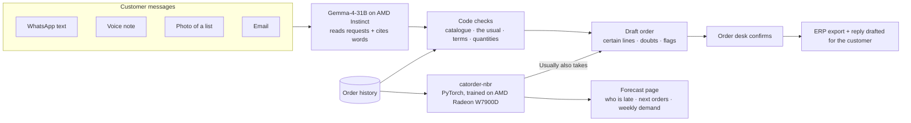

# CatOrder



**Wholesale customers order on WhatsApp. CatOrder turns their messages into checked draft orders and tells the distributor who will order next and what they will ask for. It runs on AMD: Gemma on AMD Instinct reads the messages, and a forecasting model we trained on an AMD Radeon GPU predicts the next order.**

Live demo: **https://catorder.shop** · AMD Developer Hackathon ACT III (Milan, 17–18 October 2026), Track 3 · Reinvent Commerce · MIT

## The business problem

Small and mid-size wholesale distributors (food and beverage, horeca, building supplies) sell to bars, restaurants and shops that will not use a B2B portal. They order the way they talk: a WhatsApp message at 11 pm, a voice note from the car, a photo of a list written on a delivery note, *"il solito per venerdì + 6 casse di quello rosso dell'altra volta"*.

Every morning someone at the order desk reads each message and retypes it into the ERP. That causes two problems:

1. **Order handling is slow and error-prone.** At 70 orders a day and about 4 minutes each, retyping takes roughly one full-time person. "The usual" and "the red one from last time" live in one person's memory. Wrong pack sizes, unwanted items and misread quantities become second deliveries, credit notes and lost customers.
2. **The distributor finds out too late.** No one notices that a bar which orders every Thursday has been silent for two weeks, or that an order is missing the mozzarella the customer always takes. Customers drift to a competitor before anyone calls them.

Only 7% of Italian companies are fully digital in their B2B processes (Politecnico di Milano, Digital B2b observatory, June 2026). The customer is not going to change how they order, so the order desk has to.

## Why CatOrder

- **The customer does not change anything.** CatOrder takes WhatsApp text, voice notes, photos and email as they arrive. There is no portal and no app to install.
- **It knows each customer.** "The usual", "the red one from last time" and "double the mozzarella" are resolved against that customer's own order history and agreed terms.
- **It cannot invent a line.** Every line cites the exact words it came from, and code checks that those words are in the message. The model reads; code decides on the product, the usual, unusual quantities and discounts. When something is uncertain, CatOrder asks a person instead of guessing.
- **It looks ahead.** The forecast is a trained model, not a prompt. A PyTorch network learned customers' ordering patterns on an AMD GPU and predicts next order date, basket and churn risk. The prediction is computed from numbers, not generated by an LLM.
- **The data stays with the distributor.** Prices, discounts and customer habits are a distributor's most sensitive data. Open models on AMD infrastructure mean they never go to a closed third-party model.

## How it works



### Flow 1: order handling

1. **Intake.** A message arrives on WhatsApp (live, through Twilio) or by email. Voice notes are transcribed and photos are read into text. The original always stays next to the text it became.
2. **Reading.** Gemma, served on AMD Instinct through AMD Token Factory, extracts each request: product and quantity, "the usual", a change to the usual, a delivery date, a price or discount request. Each line carries its source words.
3. **Checking, in code.** The source words must be in the message or the line is dropped. Products are matched to the catalogue. Vague products get candidates from the catalogue and the customer's past orders. "The usual" is computed from history. Unusual quantities are flagged, and discounts are compared with the agreed terms ("with the usual 8%" when the contract says 5%).
4. **Draft order.** The operator sees certain lines, lines to check (with candidates), flags and "Usually also takes" suggestions from the forecasting model, then fixes and confirms. The order is exported to the ERP, and Gemma drafts the WhatsApp reply (a confirmation, or a question about a doubtful line) for the operator to edit and send. Nothing goes to the customer or the ERP without a person.

### Flow 2: forecasting

`catorder-nbr` is a 122k-parameter PyTorch model: a GRU over each customer's last 16 orders with four heads. It was trained on an **AMD Radeon Pro W7900D with ROCm** in 169 s, on two years of synthetic history for 905 customers. For each customer it predicts:

- **When** they will order next (date, plus days overdue). This tells the seller who is late and who is coming up.
- **Whether** they are drifting away (churn risk), so the seller knows whom to call before the customer is lost.
- **What** they will order (products and quantities). This drives next week's demand per product and the "Usually also takes" suggestions that catch items missing from a draft.

How it is calculated, inputs and training are in [`model/README.md`](model/README.md). The model is served by `model/serve.py` as an internal service next to the web app on DigitalOcean.

## Benefits

| | Today | With CatOrder |
|---|---|---|
| Entering an order | read, find the usual, retype line by line | review a draft and confirm |
| "The usual", "the red one from last time" | one person's memory | computed from the customer's history |
| Discount asked beyond terms | noticed late or never | flagged on the line |
| Item the customer forgot | delivered later in a second trip | suggested in the draft ("Usually also takes") |
| Customer going silent | noticed when they're gone | on the Forecast page, with days overdue |
| Customer data | sent to closed APIs, or kept manual | open models on AMD |

What it is worth, as our assumptions (not measured): 70 orders by message a day × 4 minutes ≈ **4.7 hours of order desk time a day**, about one full-time person. 4 minutes is on the low side: vendors of order automation for food distributors report 5–8 minutes per order typed by hand ([Pepper](https://www.usepepper.com/case-studies/carolina-food-service-streamlines-order-entry-in-every-format-with-peppers-order-agent)) and 7–8 minutes for a 40-line order ([Choco](https://choco.com/us/stories/suppliers/orderagent-the-ai-order-processing-engine-thats-powering-the-future-of-food-distribution)). We found no independent time study. One wrong line delivered costs €30–80. At €199 a month per order desk, halving the typing and catching one wrong line a day pays for itself many times over. `PRODUCT.md` has the business case, the competition and go-to-market.

## Results at a glance

- **Reading orders** (Gemma-4-31B-IT on AMD Token Factory, 237 WhatsApp and email messages never used to tune the prompt): **232/237 orders entirely right (98%)**, 99.7% line precision, 99.6% line recall, 102/105 problems flagged, zero lines without verified source words. Wrong answers reviewed by hand.
- **Forecasting** (135 held-out customers): basket F1 **0.823** vs 0.803 for the strongest simple baseline, basket recall **0.898** vs 0.850, next-date error 2.81 days.
- All data is synthetic. Full tables and caveats are in [Numbers](#numbers).

## Where AMD runs

| Workload | AMD hardware |
|---|---|
| Reading messages and photos, drafting replies (Gemma-4-31B-IT) | AMD Instinct via AMD Token Factory (or vLLM on MI300X) |
| Training the next-order model (`catorder-nbr`, PyTorch + ROCm) | AMD Radeon Pro W7900D |

`PRODUCT.md` describes the product and `SPEC.md` is the build specification.

## Stack

Node 22, TypeScript (strict, ESM), Hono with `@hono/node-server`, `node:sqlite`, `tsx` to run, `vitest` for tests. The frontend is plain TypeScript compiled by `tsc` to `public/app.js`, no framework.

## Run

```
npm install
npm run build:ui     # compiles ui/app.ts to public/app.js
cp .env.example .env   # optional, see below
npm start            # http://localhost:7860
npm run demo         # mock mode, date fixed at 2026-10-18
npm test             # vitest
npm run typecheck    # tsc --noEmit
npm run eval         # the 20 demo messages in data/; CATORDER_DATA_DIR=data-eval npm run eval -- --alone for the 237-message eval
./scripts/check.sh   # typecheck + tests + secret scan
```

With `MODEL_BASE_URL` empty (or `CATORDER_MOCK=1`) the app runs in mock mode: the extraction answers in `data/mock/` are hand-written, so matching, "the usual", flags and export work with no model and no network. The mock numbers show the pipeline handles a good model's answers; they say nothing about Gemma.

Docker:

```
docker build -t catorder .
docker run -p 7860:7860 -e CATORDER_MOCK=1 catorder
```

## Environment variables

Read from the process environment, or from `.env` (real variables win).

| variable | meaning |
|---|---|
| `MODEL_BASE_URL`, `MODEL_API_KEY`, `MODEL_NAME` | any OpenAI-compatible chat endpoint |
| `MODEL_VISION` | `0` if the model takes no images: photos use the committed transcription |
| `MODEL_REASONING_EFFORT` | `none` for models that think first (Ollama gemma4, qwen3); empty = not sent |
| `MODEL_PRICE_IN_PER_M`, `MODEL_PRICE_OUT_PER_M` | USD per 1M tokens, for the cost estimate |
| `MODEL_TIMEOUT_S`, `MODEL_HARDWARE` | request timeout; top bar text |
| `TRANSCRIBE_BASE_URL`, `TRANSCRIBE_API_KEY`, `TRANSCRIBE_MODEL` | `/audio/transcriptions` endpoint; empty = committed transcripts, labelled "from file" |
| `CATORDER_DB`, `CATORDER_TODAY` | SQLite path; fixed date (`YYYY-MM-DD`) |
| `CATORDER_OFFLINE`, `CATORDER_REFRESH` | serve only cache and committed readings / ignore the cache |
| `TWILIO_ACCOUNT_SID`, `TWILIO_AUTH_TOKEN`, `PUBLIC_URL`, `WHATSAPP_PHONE_MAP`, `CATORDER_INBOX_DIR` | live WhatsApp, see below |
| `CATORDER_MOCK`, `CATORDER_DATA_DIR`, `CATORDER_CACHE_DIR`, `PORT` | force mock; data and cache dirs; port (default 7860) |

## Models on AMD

- **AMD Token Factory** (OpenAI-compatible): `MODEL_BASE_URL=https://developer.amd.com.cn/radeon/api/v1`, `MODEL_NAME=Gemma-4-31B-IT` and your `MODEL_API_KEY`. Add `MODEL_HARDWARE="AMD Instinct MI300X via AMD Token Factory"` for the top bar.
- **vLLM on an MI300X**: `vllm serve google/gemma-3-27b-it`, then `MODEL_BASE_URL=http://<host>:8000/v1`. Whisper served the same way reads voice notes via `TRANSCRIBE_*`.
- **Ollama for development**: `MODEL_BASE_URL=http://localhost:11434/v1`, `MODEL_API_KEY=ollama`, `MODEL_NAME=gemma3:12b`.
- **Next-order model** (`model/`, PyTorch, not an LLM): trained on an AMD Radeon Pro W7900D with ROCm on 905 synthetic customers. It predicts each customer's next order date, churn risk and basket, and powers the Forecast page and the "Usually also takes" suggestions. Serve it with `python3 model/serve.py` and point `PREDICT_BASE_URL` at it. Data, method and results are in `model/README.md`.

## Live WhatsApp through the Twilio Sandbox

A real WhatsApp message to Twilio's sandbox number appears in the inbox within seconds and is read like any other. Nothing is ever replied to the customer.

1. Create a Twilio account. Console, Messaging, Try it out, Send a WhatsApp message: it shows the sandbox number and a `join <two-words>` code. Send that code from your phone. The join expires after 72 hours without messages.
2. Set `TWILIO_ACCOUNT_SID`, `TWILIO_AUTH_TOKEN`, `PUBLIC_URL` and `WHATSAPP_PHONE_MAP` (see `.env.example`). Phone numbers live only in the environment and in the local database (git-ignored), never in a committed file; the number a message came from is kept so the reply can go back to it. A number not in the map is kept under the customer "Numero sconosciuto".
3. For local development, `cloudflared tunnel --url http://localhost:7860` prints a public https URL. Use it as `PUBLIC_URL`, then start the app.
4. In the Sandbox settings, set "When a message comes in" to `<PUBLIC_URL>/webhook/whatsapp`, method POST.

Text, voice notes (ogg, opus, amr, mp3) and photos (jpeg, png, webp) up to 10 MB are accepted; the media is saved in `CATORDER_INBOX_DIR` (default `data/inbox/`, git-ignored). Without `TWILIO_AUTH_TOKEN` the route answers 503.

Replies go back the same way: after a read, "Reply to …" (or "Ask the customer" on a doubtful line) has the model draft the answer into the chat, and the operator edits it and presses Send. It goes out from `TWILIO_WHATSAPP_FROM` (default the sandbox number, +14155238886) to the number the message came from (else the customer's number in `WHATSAPP_PHONE_MAP`); a customer with no number gets a demo send that delivers nothing, and the bubble says so.

## Numbers

**Reading orders.** 237 synthetic WhatsApp and email messages from the Italian order desk, none of them used to write or tune the prompt (`data-eval/`). Expected answers were generated by Claude Sonnet agents; every message the model got wrong was then reviewed by hand. Gemma-4-31B-IT on AMD Instinct via AMD Token Factory, 17 Oct 2026, each message read on its own:

| | messages | line precision | line recall | orders right | candidates hit | flags found | false flags | unverified lines |
|---|---|---|---|---|---|---|---|---|
| overall | 237 | 99.7% (774/776) | 99.6% (774/777) | **232/237 (98%)** | 90% | 102/105 | 17 | 0 |
| WhatsApp | 203 | 568/570 | 568/571 | 200/203 | 100% | 93/96 | 17 | 0 |
| email | 34 | 206/206 | 206/206 | 32/34 | 50% | 9/9 | 0 | 0 |

An order is right only when every line has the right product and the exact quantity, nothing is extra and the delivery date matches. No message that was not an order produced a line, and every line points to words that are in the message. About 4,100 tokens in and 390 out per message.

The five wrong orders: "2 latte" of oil read as two litres of milk; "una cassa e mezza" left without a quantity; a line with its price in the same sentence ("prosciutto cotto a 10 euro al chilo… 5 kg") not read; a delivery day in an email subject ("Oggetto: ordine martedì") missed; "entro mercoledì 21/10" read as the 14th. Most false flags are "ambiguous product", where the desk is asked to confirm a product the answer key resolved.

How the hand review changed the score (from 217/237 to 232/237), all recorded in `eval/match.ts` and as `note` fields in `data-eval/expected.json`: a line left without a quantity and flagged "quantity missing" counts as the expected question, not an extra line; a product missing from the catalogue left for the desk to check is not a wrong line; a removal is judged by the final order; one wrong delivery date in the answer key ("per stasera"); and five readings we accept as reasonable: "una ventina" (three messages) and an ambiguous "5 kg" left for the desk to ask, "per il weekend" read as Saturday.

The set is what Token Factory let us read: of 520 generated messages (`data-eval-complete/`), it rate-limited us at 20 requests a minute and 237 were read in full. Batches 1 and 2 are nearly complete, 3 to 5 are partial. Reproduce from the cached model outputs (`data-eval/cache/`, prompt version 1) with `CATORDER_OFFLINE=1 CATORDER_DATA_DIR=data-eval npm run eval -- --alone`.

Next-order model (`model/README.md`), trained on an AMD Radeon Pro W7900D in 169 s on 905 synthetic customers, tested on 135 it never saw, against the strongest simple method (each customer's own top items, median cadence):

| | model | simple method |
|---|---|---|
| basket F1 | **0.823** | 0.803 |
| basket recall | **0.898** | 0.850 |
| next-date error | 2.81 days | 2.82 days |
| churn AUC | 0.939 | **0.962** |

Synthetic data: the gain shows what the model can learn, not a result on a real distributor.

## Golden tests

CatOrder was first prototyped in Python. `test/golden/` holds that prototype's outputs in mock mode (today 2026-10-18, fresh DB). The tests compare the API against them after dropping volatile fields (ids, timestamps, latency); candidate scores are compared to 3 decimals.

## Data

Everything in `data/` is invented: distributor, customers, products, prices, messages. Voice notes are synthesised with ElevenLabs from the scripts next to them (`scripts/make_voice.py`); the photos are placeholders rendered by `scripts/make_photos.py` until replaced by real handwritten lists (`data/messages/PHOTOS.md`). `scripts/check_data.py` checks the data's consistency.

## License

MIT.
